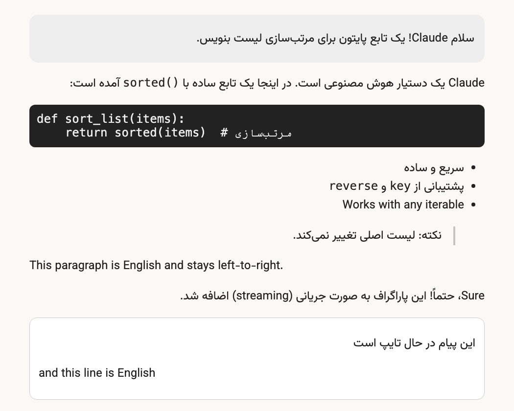
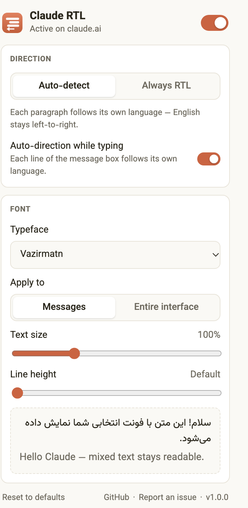
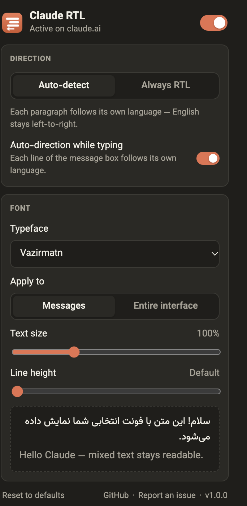

<div align="center">


# Claude RTL

**Right-to-left support and beautiful fonts for [Claude](https://claude.ai) — for Persian, Arabic, Hebrew and Urdu speakers.**

[](https://github.com/afshinghezeli/claude-rtl-extension/actions/workflows/ci.yml)
[](https://github.com/afshinghezeli/claude-rtl-extension/releases/latest)
[](LICENSE)
[](https://developer.chrome.com/docs/extensions/develop/migrate/what-is-mv3)
[](CONTRIBUTING.md)

[Install](#-installation) · [Features](#-features) · [Settings](#%EF%B8%8F-settings) · [Contributing](CONTRIBUTING.md) · [فارسی](#-فارسی)



</div>

---

## ✨ Features

- **Smart, per-paragraph direction** — every paragraph, list, heading, quote and table cell is aligned by _its own_ language. English stays left-to-right, Persian/Arabic goes right-to-left, in the same message.
- **Handles real-world mixed text** — sentences like `Claude یک دستیار هوش مصنوعی است` are correctly detected as RTL (the browser's built-in `dir="auto"` gets this wrong).
- **Code always stays LTR** — code blocks, inline code and math are never flipped.
- **Live while streaming** — responses switch direction as Claude writes them, with no flicker or lag.
- **RTL-aware message box** — each line you type aligns to its language, without interfering with the editor.
- **Beautiful bundled fonts** — Vazirmatn, Shabnam, Sahel and Samim ship with the extension (no network requests), plus system fonts or _any font installed on your computer_.
- **Fine-tuning** — text size, line height, and whether the font applies to messages only or the whole interface.
- **Keyboard shortcut** — <kbd>Alt</kbd>+<kbd>Shift</kbd>+<kbd>R</kbd> toggles everything on/off.
- **Private by design** — no analytics, no network calls, one permission (`storage`). See [PRIVACY.md](PRIVACY.md).
- **Localized** — popup available in English and Persian; easy to add more languages.

<p align="center">
  
  &nbsp;&nbsp;
  
</p>

## 📦 Installation

### Chrome Web Store

_Coming soon._ Star ⭐ or watch the repository to be notified.

### From a release (recommended for now)

1. Download `claude-rtl-x.y.z.zip` from the [latest release](https://github.com/afshinghezeli/claude-rtl-extension/releases/latest) and unzip it.
2. Open `chrome://extensions` and turn on **Developer mode** (top-right).
3. Click **Load unpacked** and select the unzipped folder.
4. Reload any open claude.ai tabs.

Works in every Chromium browser: Chrome, Edge, Brave, Arc, Opera, Vivaldi.

### From source

```bash
git clone https://github.com/afshinghezeli/claude-rtl-extension.git
cd claude-rtl-extension
npm install
npm run build        # outputs the extension to dist/
```

Then load the `dist/` folder as in step 3 above.

## ⚙️ Settings

Click the extension icon in the toolbar to open the settings. Changes apply instantly to every open claude.ai tab and sync across your devices.

| Setting                         | Options                                                                     | Default     |
| ------------------------------- | --------------------------------------------------------------------------- | ----------- |
| **Enabled**                     | on / off (also <kbd>Alt</kbd>+<kbd>Shift</kbd>+<kbd>R</kbd>)                | on          |
| **Direction**                   | _Auto-detect_ per paragraph, or _Always RTL_                                | Auto-detect |
| **Auto-direction while typing** | on / off                                                                    | on          |
| **Typeface**                    | Claude default, Vazirmatn, Shabnam, Sahel, Samim, Tahoma, System UI, Custom | Vazirmatn   |
| **Apply to**                    | Messages, Entire interface                                                  | Messages    |
| **Text size**                   | 80% – 150%                                                                  | 100%        |
| **Line height**                 | Default, 1.2 – 2.4                                                          | Default     |

> **Custom fonts:** choose _Custom_ and type the name of any font installed on your system (for example `IRANSans` or `B Nazanin`).
>
> **Shortcut:** change it at `chrome://extensions/shortcuts`.

## 🧠 How it works

A content script watches claude.ai with a `MutationObserver` (batched to one update per animation frame) and sets `dir="rtl"` on text blocks whose letters are mostly from right-to-left scripts. Fonts are loaded via the `FontFace` API from files inside the extension, so they work regardless of the site's Content-Security-Policy. All styling is in one stylesheet gated by classes on `<html>`, so turning the extension off restores the page exactly.

Read [docs/ARCHITECTURE.md](docs/ARCHITECTURE.md) for the details.

## 🛠️ Development

Requires **Node.js 22.2+**.

```bash
npm install
npm run dev          # build to dist/ and rebuild on change
```

Load `dist/` as an unpacked extension, then press the reload icon on `chrome://extensions` after changes to the background worker or manifest (content-script changes only need a page reload).

| Script            | Description                                           |
| ----------------- | ----------------------------------------------------- |
| `npm run dev`     | Development build with watch mode and source maps     |
| `npm run build`   | Production build to `dist/`                           |
| `npm run package` | Production build + `release/claude-rtl-<version>.zip` |
| `npm test`        | Unit tests (Vitest + jsdom)                           |
| `npm run lint`    | ESLint                                                |
| `npm run format`  | Prettier                                              |
| `npm run check`   | Everything CI runs: lint, format check, tests, build  |

### Project structure

```
src/
├── manifest.json          Extension manifest (version is injected from package.json)
├── background/            Service worker: defaults, keyboard shortcut, badge
├── content/               Content script running on claude.ai
│   ├── index.js           Entry point
│   ├── direction-engine.js  Detects & applies direction to text blocks
│   ├── style-manager.js   Applies font/size settings as classes + CSS variables
│   ├── selectors.js       ← All knowledge about claude.ai's DOM
│   └── content.css        Page styles (gated by <html> classes)
├── popup/                 Settings UI
├── shared/                Settings schema, direction detection, font catalog
├── fonts/                 Bundled OFL fonts (with licenses)
├── icons/                 Generated by scripts/generate-icons.mjs
└── _locales/              i18n messages (en, fa)
tests/                     Unit tests
scripts/                   Build, packaging and icon generation
```

## 🤝 Contributing

Contributions are very welcome — bug reports, new fonts, translations and code alike. Please read the [contributing guide](CONTRIBUTING.md) and our [code of conduct](CODE_OF_CONDUCT.md).

**Something broke after a claude.ai update?** It's almost always a selector. Check [`src/content/selectors.js`](src/content/selectors.js) and the selectors at the top of [`content.css`](src/content/content.css), then [open an issue](https://github.com/afshinghezeli/claude-rtl-extension/issues/new/choose).

## 🗺️ Roadmap

- [ ] Publish to the Chrome Web Store and Edge Add-ons
- [ ] Firefox support
- [ ] Per-conversation direction override
- [ ] More bundled fonts (e.g. Noto Naskh Arabic, Estedad)
- [ ] More UI languages (Arabic, Hebrew, Urdu)

Have an idea? [Request a feature](https://github.com/afshinghezeli/claude-rtl-extension/issues/new?template=feature_request.yml).

## ❓ FAQ

<details>
<summary><strong>Nothing changed after installing.</strong></summary>

Reload your claude.ai tabs — content scripts only attach to pages loaded after installation. Also make sure the toolbar icon doesn't show an <code>OFF</code> badge.

</details>

<details>
<summary><strong>An English paragraph became right-aligned (or vice versa).</strong></summary>

In <em>Auto-detect</em> mode a block is RTL when at least 30% of its letters are from an RTL script. If you find a case that is detected badly, please open a bug report with the text.

</details>

<details>
<summary><strong>Does it read or send my conversations anywhere?</strong></summary>

No. The extension has no network access to any server, collects nothing and only stores your settings in Chrome sync storage. See <a href="PRIVACY.md">PRIVACY.md</a>.

</details>

## 🌐 فارسی

<div dir="rtl">

**Claude RTL** یک افزونهٔ متن‌باز کروم است که گفتگوهای فارسی، عربی، عبری و اردو را در [claude.ai](https://claude.ai) راست‌چین می‌کند.

- هر پاراگراف بر اساس زبان خودش چیده می‌شود؛ متن انگلیسی و کدها چپ‌چین می‌مانند.
- جمله‌هایی که با یک کلمهٔ انگلیسی شروع می‌شوند (مثل «Claude یک دستیار است») هم درست تشخیص داده می‌شوند.
- فونت‌های وزیرمتن، شبنم، ساحل و صمیم همراه افزونه هستند؛ یا هر فونتی که روی سیستم خود نصب کرده‌اید.
- تنظیم اندازهٔ متن و فاصلهٔ خطوط، و میانبر <kbd>Alt</kbd>+<kbd>Shift</kbd>+<kbd>R</kbd> برای روشن و خاموش کردن.

برای نصب، فایل zip را از [آخرین نسخه](https://github.com/afshinghezeli/claude-rtl-extension/releases/latest) دانلود کنید، در `chrome://extensions` حالت Developer mode را روشن کنید و با **Load unpacked** پوشهٔ استخراج‌شده را انتخاب کنید.

اگر این افزونه برایتان مفید بود، با دادن ⭐ به پروژه از آن حمایت کنید.

</div>

## 📄 License

[MIT](LICENSE) © Afshin Ghezeli.
Bundled fonts are licensed under the [SIL Open Font License 1.1](THIRD_PARTY_NOTICES.md).

## 🙏 Acknowledgments

- [Saber Rastikerdar](https://github.com/rastikerdar) for the Vazirmatn, Shabnam, Sahel and Samim fonts.
- Everyone who [contributes](https://github.com/afshinghezeli/claude-rtl-extension/graphs/contributors).

---

<sub>Claude RTL is an independent, community project and is not affiliated with, endorsed by, or sponsored by Anthropic. “Claude” is a trademark of Anthropic, PBC.</sub>
